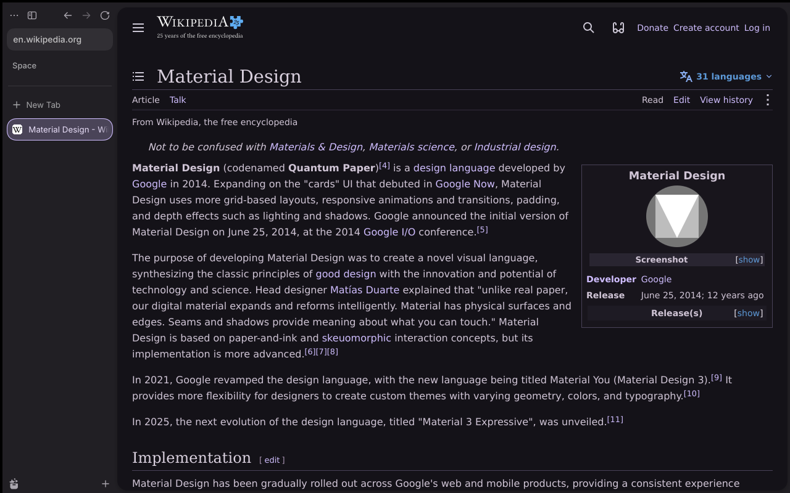
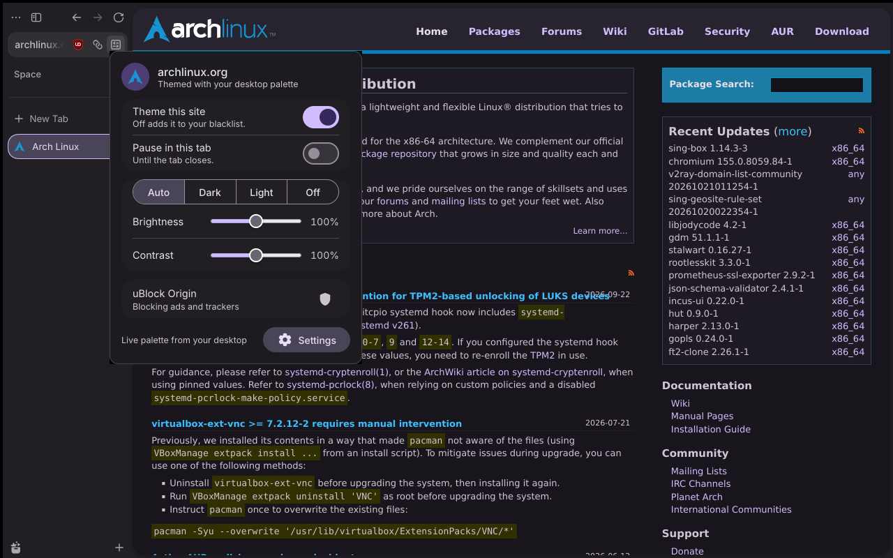
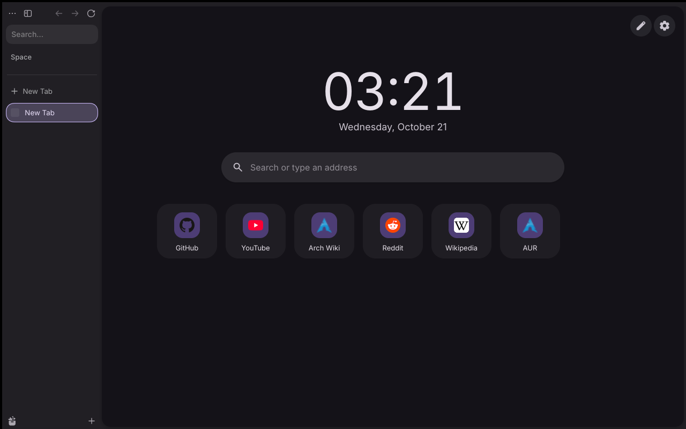
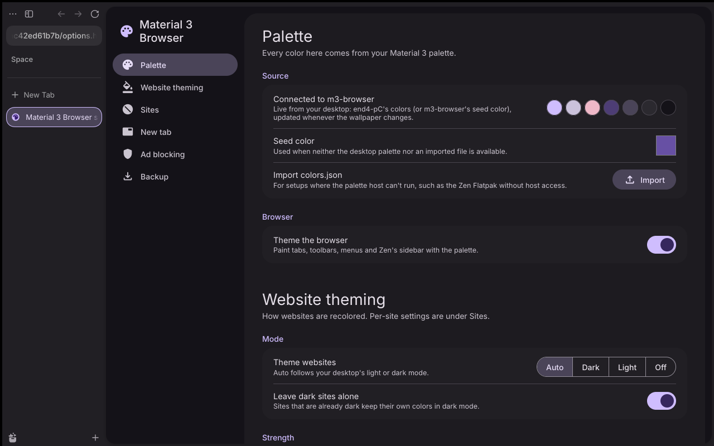
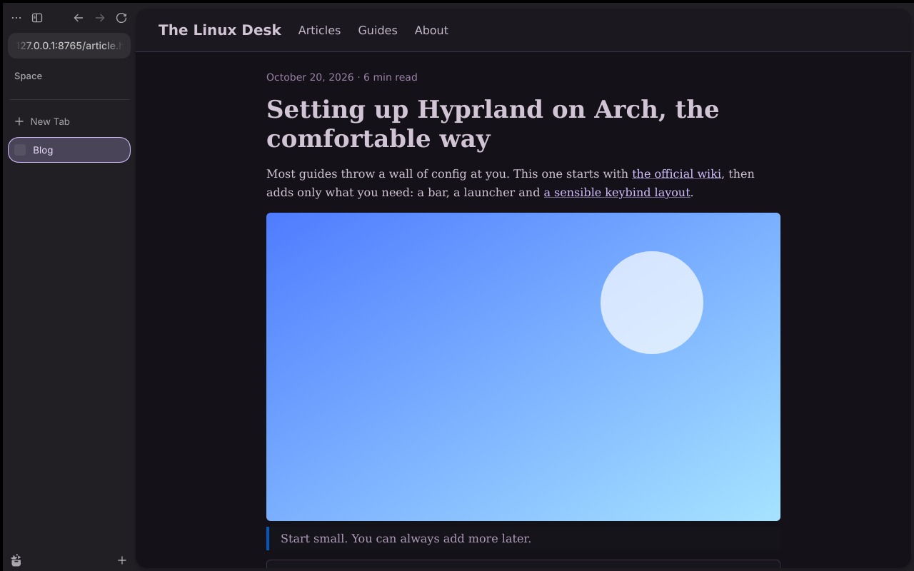
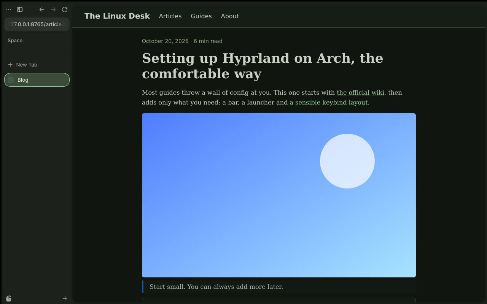
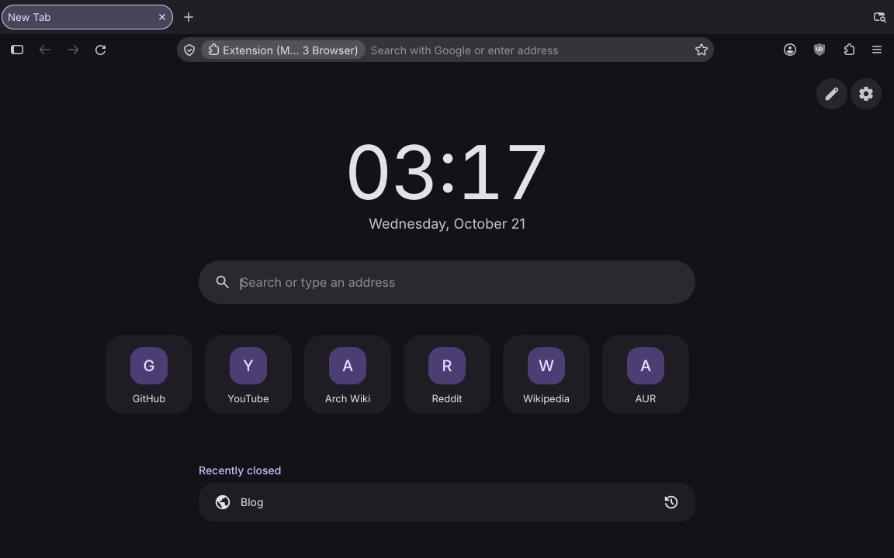

# Material 3 Browser

[Zen](https://zen-browser.app) with your Material 3 palette. Websites, the browser interface and the new tab page all take their colors from your end4-pC wallpaper and change live when it does. It also comes with ad blocking and its own profile, window class and dock icon. It's part of the Material 3 family with the [file manager](https://github.com/bhimio1/material-3-file-manager-rust), [settings](https://github.com/bhimio1/material-3-settings), [music](https://github.com/bhimio1/material-3-music) and [games](https://github.com/bhimio1/material-3-games) apps.

It isn't a Firefox fork: it runs the Zen (or Firefox/LibreWolf) you already have, so browser updates keep coming through pacman. On top of that it adds a profile, Material 3 stylesheets and a WebExtension, all set up by the `m3-browser` launcher.






The same page before and after the wallpaper (and so the palette) changes:




Screenshots are of the real browsers (Zen 1.23, and Firefox 158 below), taken while testing.



## Features

**Websites in your palette**
- **Engine:** pages are recolored with Dark Reader's dynamic engine (MIT, bundled with its per-site fixes), using your Material 3 surface and on-surface colors.
- **Accents:** text links, focus rings, checkboxes, sliders and the text cursor use your primary color.
- **Light and dark:** follows your desktop's mode, or always dark, always light or off.
- **Live:** open tabs re-theme when the wallpaper (and so the palette) changes.
- **Dark sites:** sites that are already dark are left alone in dark mode (checked once per site and remembered for 30 days; "Theme it anyway" in the popup, or turn it off).
- **Strength:** brightness, contrast, sepia and greyscale; images can be dimmed, videos are left alone, scrollbars are themed, and every site's font can be replaced.

**Blacklist and per-site options**
- **Lists:** a blacklist, or a whitelist mode ("only theme these sites").
- **Patterns:** `example.com` (with subdomains), `*.example.com`, `google.*`, `github.com/*/settings`, or `/regex/`.
- **Per site:** mode, strength, background and text colors, and custom CSS.
- **Toolbar popup:** theme or skip the current site, pause theming in a tab, switch modes, and adjust brightness and contrast.
- **Backup:** import and export all settings as JSON.

**The browser itself**
- **Live colors:** the extension recolors tabs, toolbars, the address bar, menus and Zen's sidebar from the palette. `userChrome.css` maps Zen's own color variables onto it.
- **Material 3 shapes:** pill tabs and address bar, 16 px radii, rounded menus, and the Inter font.
- **New tab page:** clock, search with the browser's own engines, an editable speed dial, recently closed tabs, and your end4-pC wallpaper behind it.
- **Ad blocking:** uBlock Origin is downloaded from addons.mozilla.org on the first start (only installed if Mozilla-signed) and then keeps itself updated.
- **Privacy defaults:** no telemetry, studies, Pocket or sponsored content; strict tracking protection.
- **Profile:** a separate profile, with an optional import of bookmarks, history and passwords from your Zen, Firefox or LibreWolf profile.

## Signing: why the extension might not load on Zen yet

Zen and Firefox's regular releases only run add-ons **signed by Mozilla**. LibreWolf and Firefox Developer Edition, Nightly and ESR can run unsigned ones.

- **Signed releases.** The release workflow signs the extension as an *unlisted* add-on (never published on the store) when the repository has the secrets `AMO_JWT_ISSUER` and `AMO_JWT_SECRET`. These come from a free addons.mozilla.org account, under Tools → Manage API Keys. Signed releases install permanently on Zen with no extra steps.
- **Until then, use development loading.** Turn it on in `m3-browser --settings` → Extension & signing. The launcher then installs the extension temporarily on every start, the way `web-ext run` does. It's **off by default**: while the browser runs it opens a debugging socket (in your private runtime folder, `$XDG_RUNTIME_DIR/m3-browser`), which any program running as you could use to control the browser. If that path is too long for a socket, it uses `/tmp/m3-browser-<uid>` instead, made private to you, and refuses to start if someone else owns it. It isn't available for the Zen Flatpak.
- **Or use LibreWolf**, where the unsigned extension installs normally.

Without the extension you still get the profile, the Material 3 shapes (in neutral colors) and uBlock Origin.

## Tested

In October 2026, on X11 (Xvfb, no window manager), with fresh profiles made by the launcher:

| | Zen 1.23.3b | Firefox 158.0.1 | Firefox ESR 153.5.1 |
|---|---|---|---|
| Extension | development loading | development loading | unsigned, sideloaded |
| uBlock Origin from AMO (signature checked) | ✓ | ✓ | ✓ |
| Profile, `user.js`, no first-run screens | ✓ | ✓ | ✓ |
| `WM_CLASS` `material_3_browser` | ✓ | ✓ | ✓ |
| Palette over native messaging, live updates | ✓ | ✓ | ✓ |
| Browser interface in the palette | ✓ | ✓ | ✓ |
| Websites, dark-site skipping, blacklist, per-site mode | ✓ | ✓ (sample pages) | ✓ (sample pages) |
| Popup, settings and new tab pages | ✓ | ✓ | ✓ |

Real sites were checked in Zen: Wikipedia, GitHub (left alone, it's already dark) and archlinux.org.

**Not tested yet:** a real Hyprland/Wayland session, LibreWolf, the Zen Flatpak, the end4-pC wallpaper behind the new tab page, and importing from an existing profile.

**Known limitations**
- Regular Zen and Firefox releases only keep the extension until they close; the launcher installs it again on every start (development loading) until releases are signed by Mozilla. Settings are kept between starts.
- Dark-site detection is per site (origin), so one dark page can make a whole site count as dark. "Theme it anyway" in the popup fixes that for the site.
- Speed dial icons are fetched from DuckDuckGo's icon service.

## Install

From the AUR (once a release is published):

```sh
paru -S material-3-browser-bin   # or material-3-browser-git
paru -S zen-browser-bin          # the engine, or: flatpak install flathub app.zen_browser.zen
```

Prebuilt binaries are also attached to [releases](https://github.com/bhimio1/material-3-browser/releases). From source:

```sh
cargo build --release
cd extension && npm ci && npm run stage && cd ..
./target/release/m3-browser --settings
```

When run from the repository, `m3-browser` finds the staged extension in `extension/stage/`. Installed, it looks in `/usr/share/m3-browser` or `~/.local/share/m3-browser`.

## Usage

- `m3-browser [URL…]` starts the browser. The first run opens the setup window instead.
- `m3-browser --settings` opens the setup window: engine, extension and signing, uBlock Origin, import, palette.
- `m3-browser --status` prints what would run.
- `material_3_browser.desktop` registers it as a web browser, so Material 3 Settings → Default apps can make it the default.

Website-theming options are in the browser: click the palette button in the toolbar, or open the extension's settings in about:addons.

## How the palette gets in

1. The launcher installs a native messaging host: `m3-browser --native-host`, registered under `~/.mozilla`, `~/.zen`, `~/.librewolf` and `~/.config/mozilla`.
2. The host reads end4-pC's `~/.local/state/quickshell/user/generated/colors.json` (or the seed color in `~/.config/m3-browser/config.toml`), sends both the light and dark schemes, and pushes an update whenever the file changes.
3. The extension caches the last palette, so pages theme instantly on start.

**Zen Flatpak:** the host has to run outside the sandbox through `flatpak-spawn`, which needs the `org.freedesktop.Flatpak` permission. The setup window can grant it. Otherwise, import a `colors.json` in the extension's settings, or use the seed color.

## Project layout

```
launcher/     m3-browser (Rust): engine detection, profile, native host, uBlock Origin,
              development loading, setup window (shared Material 3 egui style)
profile/      user.js and the chrome stylesheets (userChrome.css maps Zen's colors onto
              the theme API; m3-compat.css holds the markup-dependent selectors;
              m3-custom.css in the profile is yours and never overwritten)
extension/    the WebExtension (TypeScript + esbuild): background, content script,
              popup, settings and new tab pages, tests, visual render harness
packaging/    desktop entry, PKGBUILD (-git) and the -bin template
```

Checks: `cargo test`, and in `extension/`: `npm test`, `npm run typecheck`, `npx web-ext lint --source-dir dist`. `npm run render` themes the sample pages in `test/visual/fixtures` in headless Chromium and writes before/after screenshots.

## License

MIT, see [LICENSE](LICENSE). Bundled third-party software (Dark Reader's engine and site fixes, Material Color Utilities, Inter, Material Symbols) is listed in [extension/LICENSE-THIRD-PARTY.md](extension/LICENSE-THIRD-PARTY.md). uBlock Origin (GPLv3) is downloaded from addons.mozilla.org, not bundled.
